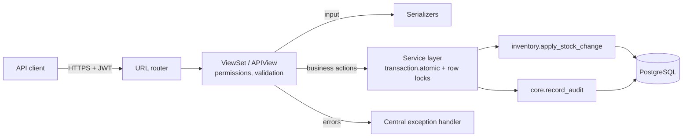

# StockFlow ERP API


StockFlow ERP API is a REST backend for a small ERP focused on **inventory, sales and purchasing**. It manages products, warehouses, stock levels, customer sales orders and supplier purchase orders, and it keeps stock correct under concurrent requests.

It is a personal portfolio project built with Django and Django REST Framework. The emphasis is on backend engineering: explicit business rules, transactional services, database constraints, role-based access, and automated tests (including concurrency tests).

- **Author:** [chaimaaelaffas1](https://github.com/chaimaaelaffas1)
- **Status:** feature-complete for the scope below. It has been verified locally with Docker (see [Testing and quality](docs/08-testing-and-quality.md)). It is **not** presented as production-ready; see [Known limitations](#known-limitations-and-future-improvements).

## The problem it solves

A trading or distribution business must answer three questions reliably: *what do we have, what is already promised to customers, and what is on its way from suppliers?* Doing this with spreadsheets leads to overselling, double-counted deliveries and no audit trail.

StockFlow models the full chain and enforces the rules in code and in the database:

- Confirming a sales order **reserves** stock; shipping it **removes** stock; cancelling releases the reservation.
- Receiving goods against a purchase order is **idempotent** and cannot exceed the ordered quantity.
- Every stock change is written to an **immutable ledger** (`StockMovement`).
- Business events are recorded in an **audit log** readable by administrators.

## Main features

| Area | What is implemented |
|---|---|
| Authentication | Email + password login, JWT access/refresh tokens, refresh rotation with blacklist, logout |
| Authorization | 5 roles (`ADMIN`, `STOCK_MANAGER`, `SALES`, `PURCHASER`, `VIEWER`) enforced per endpoint/action |
| Partners | Customers and suppliers (CRUD, search, filter, soft deactivation via `is_active`) |
| Catalog | Categories and products (case-insensitive unique SKU, price/reorder-level constraints, deactivate action) |
| Inventory | Warehouses, stock levels (`on_hand`, `reserved`, computed `available`), immutable stock movements, manual adjustments with mandatory reason |
| Sales | Orders with status machine `DRAFT → CONFIRMED → SHIPPED` (or `CANCELLED`), stock reservation, price frozen at confirmation |
| Purchasing | Orders with status machine `DRAFT → ORDERED → PARTIALLY_RECEIVED → RECEIVED` (or `CANCELLED`), partial receipts, idempotency keys |
| Dashboard | One aggregation endpoint (counts, out-of-stock, low-stock, stock value, orders by status) |
| Audit | Read-only audit log endpoint (admin only) for sales/purchase order events |
| API docs | OpenAPI 3 schema, Swagger UI and ReDoc via drf-spectacular |
| Quality | Ruff, pre-commit, GitHub Actions CI, 183 tests |

## Technology stack

| Layer | Technology |
|---|---|
| Language | Python 3.12 |
| Framework | Django 5.2, Django REST Framework |
| Auth | djangorestframework-simplejwt (with token blacklist) |
| Filtering | django-filter, DRF `SearchFilter` / `OrderingFilter` |
| API docs | drf-spectacular (+ sidecar for ReDoc) |
| Database | PostgreSQL 16 (psycopg 3) |
| Config | django-environ (`.env`) |
| Production server | gunicorn + WhiteNoise (production Docker target) |
| Testing | pytest, pytest-django, pytest-cov (`factory-boy` and `pytest-repeat` are in the dev requirements but not used by the current tests) |
| Quality | Ruff (lint + format), pre-commit, GitHub Actions |
| Containers | Docker (multi-stage `dev` / `prod`), Docker Compose |

## Architecture overview



Views stay thin. State-changing business logic (confirm, ship, cancel, place, receive, adjust) lives in `services.py` modules and runs inside database transactions with row-level locks. Details: [Architecture](docs/02-architecture.md).

## Main modules

| App | Responsibility |
|---|---|
| `apps/accounts` | Custom `User` (email login + role), JWT endpoints, role permissions, user management |
| `apps/partners` | `Customer`, `Supplier` |
| `apps/catalog` | `Category`, `Product` |
| `apps/inventory` | `Warehouse`, `StockLevel`, `StockMovement`, stock services and adjustments |
| `apps/sales` | `SalesOrder`, `SalesOrderLine`, sales services |
| `apps/purchasing` | `PurchaseOrder`, `PurchaseOrderLine`, `Receipt`, `ReceiptLine`, purchasing services |
| `apps/core` | `AuditLog`, exceptions, error handler, pagination, dashboard, health check, `seed_demo` command |

## Database overview

15 domain tables plus Django/JWT-blacklist tables. Integrity is enforced with `CHECK` and `UNIQUE` constraints (for example `reserved <= on_hand`, case-insensitive unique SKU). See [Database design](docs/03-database-design.md) for the ER diagram.

## Quick start with Docker

Prerequisites: Docker and Docker Compose.

```bash
git clone <your-repository-url>
cd stockflow-erp-api

cp .env.example .env          # then edit the values (see Environment configuration)
docker compose up -d --build  # starts PostgreSQL 16 and the API (runserver)

docker compose exec api python manage.py migrate
docker compose exec api python manage.py createsuperuser   # asks for email + password
docker compose exec api python manage.py seed_demo         # optional fictitious demo data
```

The API is then available at <http://localhost:8000/>. Check it:

```bash
curl http://localhost:8000/api/v1/health/
# {"status": "ok"}
```

> The compose file builds the code into the image (no bind mount). After changing code, rebuild with `docker compose up -d --build`.

More options (local virtualenv, troubleshooting): [Docker and local development](docs/09-docker-and-local-development.md).

## Environment configuration

Copy `.env.example` to `.env`. Never commit `.env`.

| Variable | Required | Purpose |
|---|---|---|
| `SECRET_KEY` | yes | Django secret key (generate a new one) |
| `DEBUG` | no (default `False`) | Debug mode, for local development only |
| `ALLOWED_HOSTS` | no | Comma-separated hostnames |
| `DATABASE_URL` | yes | PostgreSQL connection URL |
| `POSTGRES_DB`, `POSTGRES_USER`, `POSTGRES_PASSWORD` | for Docker Compose | Database container credentials |
| `LOG_LEVEL` | no (default `INFO`) | Root log level |

Production-only variables are listed in [Docker and local development](docs/09-docker-and-local-development.md#production-image).

## Authenticating and calling the API

```bash
# 1. Obtain tokens
curl -X POST http://localhost:8000/api/v1/auth/token/ \
  -H 'Content-Type: application/json' \
  -d '{"email":"admin@example.com","password":"<your-password>"}'
# -> {"refresh":"...","access":"..."}

# 2. Call a protected endpoint
curl http://localhost:8000/api/v1/auth/me/ -H "Authorization: Bearer <access-token>"
```

Example (captured from a local run against the demo data): create and confirm a sales order.

```bash
curl -X POST http://localhost:8000/api/v1/sales/sales-orders/ \
  -H "Authorization: Bearer <access-token>" -H 'Content-Type: application/json' \
  -d '{"customer":1,"warehouse":1,"lines":[{"product":1,"quantity":"2.000"}]}'

curl -X POST http://localhost:8000/api/v1/sales/sales-orders/1/confirm/ \
  -H "Authorization: Bearer <access-token>"
```

```json
{
  "id": 1, "number": "SO-000001", "status": "CONFIRMED",
  "lines": [{"product": 1, "product_name": "Marteau", "quantity": "2.000",
             "unit_price": "85.00", "line_total": "170.000"}],
  "total": "170.000"
}
```

Insufficient stock returns a business error (HTTP 409):

```json
{"error": {"code": "insufficient_stock",
           "message": "Not enough available stock.",
           "details": {"product": 2, "warehouse": 1, "available": "10.000", "requested_change": "9999.000"}}}
```

Full reference: [API reference](docs/06-api-reference.md).

## API documentation

With the server running:

| Tool | URL |
|---|---|
| Swagger UI | <http://localhost:8000/api/schema/swagger-ui/> |
| ReDoc | <http://localhost:8000/api/schema/redoc/> |
| Raw OpenAPI schema | <http://localhost:8000/api/schema/> |

A generated copy of the schema is committed as `schema.yml`. Swagger UI loads its JavaScript from a CDN (jsDelivr), so it needs internet access; ReDoc is served from the bundled sidecar package.

## Running the tests

Tests need PostgreSQL (a smoke test asserts it, and the concurrency tests rely on row locking).

```bash
docker compose run --rm api pytest -q                              # all tests
docker compose run --rm api pytest -q --cov=apps --cov-report=term # with coverage
```

Last local verification (2026-11-16): **183 tests passed**, **86 % statement coverage** on `apps/` (includes migrations and the untested `seed_demo` command). Ruff lint and format checks passed. See [Testing and quality](docs/08-testing-and-quality.md).

## Project structure

```text
.
├── apps/
│   ├── accounts/     # User model, JWT views, role permissions
│   ├── catalog/      # Category, Product
│   ├── core/         # AuditLog, exceptions, handler, dashboard, seed_demo
│   ├── inventory/    # Warehouse, StockLevel, StockMovement, stock services
│   ├── partners/     # Customer, Supplier
│   ├── purchasing/   # PurchaseOrder, Receipt, purchasing services
│   └── sales/        # SalesOrder, sales services
├── config/           # settings (base/dev/prod/test), urls, wsgi/asgi
├── tests/            # pytest suite, mirrors the apps layout
├── docs/             # project documentation
├── requirements/     # base.txt, dev.txt, prod.txt
├── .github/workflows/ci.yml
├── docker-compose.yml
├── Dockerfile        # stages: base, dev, prod
├── pyproject.toml    # Ruff configuration
├── pytest.ini
└── schema.yml        # generated OpenAPI schema
```

## Documentation index

Suggested reading order:

1. [Project overview](docs/01-project-overview.md)
2. [Architecture](docs/02-architecture.md)
3. [Database design](docs/03-database-design.md)
4. [Business workflows](docs/04-business-workflows.md)
5. [Inventory and stock management](docs/07-inventory-and-stock-management.md)
6. [Authentication and permissions](docs/05-authentication-and-permissions.md)
7. [API reference](docs/06-api-reference.md)
8. [Testing and quality](docs/08-testing-and-quality.md)
9. [Docker and local development](docs/09-docker-and-local-development.md)
10. [Development guide](docs/10-development-guide.md)
11. [Technical decisions, limitations and roadmap](docs/11-technical-decisions.md)

## Security considerations

- JWT access tokens last 15 minutes; refresh tokens last 1 day, are rotated on use and blacklisted after rotation. Logout blacklists the refresh token.
- Every endpoint except `/api/v1/auth/token/`, `/api/v1/auth/token/refresh/`, `/api/v1/health/` and the schema/docs pages requires authentication. Role checks are enforced per action.
- Serializers expose `status`, `number`, timestamps and computed prices as read-only, so clients cannot bypass the state machines.
- Passwords are hashed by Django; they are write-only in the API.
- Throttling is configured (anonymous 30/min, user 300/min, login 5/min). The default Django cache is per-process, so limits are per worker; use a shared cache in a real deployment.
- Secrets come from environment variables. `.env` is git-ignored and excluded from the Docker build context.
- `django-cors-headers` is installed but its middleware is **not** enabled, so no CORS headers are sent. Browser front-ends on another origin would need this configured.

More detail: [Authentication and permissions](docs/05-authentication-and-permissions.md#security-notes).

## Known limitations and future improvements

Not implemented: invoicing/payments, customer returns, warehouse-to-warehouse transfers, batches/serial numbers, stock valuation (FIFO/average cost), multi-currency or multi-company, background jobs, application cache, monitoring. Stock value in the dashboard uses the current list price and is indicative only.

Audit coverage is partial: stock adjustments, user/role changes and catalog/partner edits are not written to the audit log. The refresh token is returned in the JSON body. The production Docker image requires `DJANGO_SETTINGS_MODULE=config.settings.prod` to be set at runtime. The full list, with explanations, is in [Technical decisions](docs/11-technical-decisions.md).

## License

No license file is included in this repository. Until one is added, all rights are reserved by the author.
