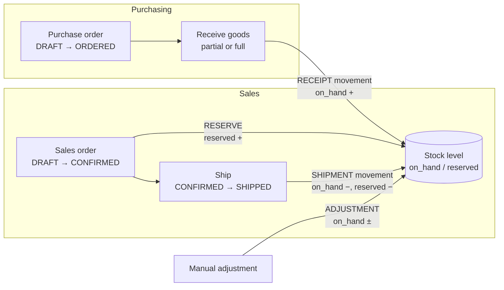

# 01 — Project overview

[README](../README.md) · Next: [02 Architecture](02-architecture.md)

## Purpose

StockFlow ERP API is the backend of a small inventory-centred ERP. It answers, through a REST API, three operational questions:

1. **What stock do we hold, and where?** (products × warehouses)
2. **What is already promised to customers?** (reservations created by confirmed sales orders)
3. **What is expected from suppliers?** (purchase orders and goods receipts)

The project exists to demonstrate backend engineering practice: explicit business rules, transactional integrity, concurrency-safe stock updates, role-based access control and a serious test suite. It is a learning/portfolio project; no real customer or production deployment is claimed.

## Target users

| Persona | Role in the system | Typical actions |
|---|---|---|
| Administrator | `ADMIN` | Manage users and roles, everything else, read the audit log |
| Stock manager | `STOCK_MANAGER` | Maintain catalog and warehouses, adjust stock, ship sales orders, receive purchase orders |
| Sales representative | `SALES` | Manage customers, create/confirm/cancel sales orders |
| Purchasing manager | `PURCHASER` | Manage suppliers, create/place/cancel purchase orders |
| Viewer | `VIEWER` | Read-only access to most data |

The exact permission matrix is in [05 Authentication and permissions](05-authentication-and-permissions.md).

## Functional scope

### Implemented

| Module | Capabilities |
|---|---|
| Authentication | Login with email/password, JWT refresh with rotation, logout (refresh blacklist), "me" endpoint |
| Users | Admin-only create/list/retrieve/update (no delete); last-active-admin self-protection |
| Partners | Customers and suppliers: CRUD, search, `is_active` filter, ordering, admin-only delete |
| Catalog | Categories and products, SKU normalisation (upper-case, case-insensitive unique), filters, search, ordering, `deactivate` action. No product delete endpoint |
| Inventory | Warehouses (no delete), stock levels (read-only), stock movements (read-only, immutable), manual stock adjustment |
| Sales | Draft editing, confirm (reserve), ship, cancel, delete drafts |
| Purchasing | Draft editing, place, cancel, receive (partial, idempotent), receipts (read-only) |
| Dashboard | Aggregated counts, stock indicators, orders by status |
| Audit | Read-only, filterable audit log (admin) |
| Operations | Health endpoint, OpenAPI/Swagger/ReDoc, demo-data command |

### Not implemented (out of scope)

Invoicing and payments, customer returns, transfers between warehouses, lot/serial tracking, stock valuation methods (FIFO / weighted average), multi-currency, multi-company, background tasks, notifications, file uploads. See [11 Technical decisions](11-technical-decisions.md#known-limitations).

## Main business workflows

Every arrow into the stock level also writes a row to the immutable stock-movement ledger. Step-by-step descriptions are in [04 Business workflows](04-business-workflows.md).

## Key concepts and terminology

| Term | Meaning in this project |
|---|---|
| `on_hand` | Physical quantity in a warehouse |
| `reserved` | Quantity promised to confirmed, not yet shipped sales orders |
| `available` | `on_hand − reserved` (computed, not stored) |
| Stock movement | Immutable ledger row describing one change to `on_hand` and/or `reserved` |
| Service | A function in `services.py` that performs a state-changing business operation inside a transaction |
| Business rule error | Exception from `apps/core/exceptions.py`, returned as HTTP 409 with a stable `code` |

Quantities use 3 decimal places; money uses 2 decimal places. The API serialises decimals as JSON strings (for example `"2.000"`), which is the DRF default and avoids floating-point loss.

## Where to go next

- How the code is organised: [02 Architecture](02-architecture.md)
- Data model: [03 Database design](03-database-design.md)
- Running it: [09 Docker and local development](09-docker-and-local-development.md)
