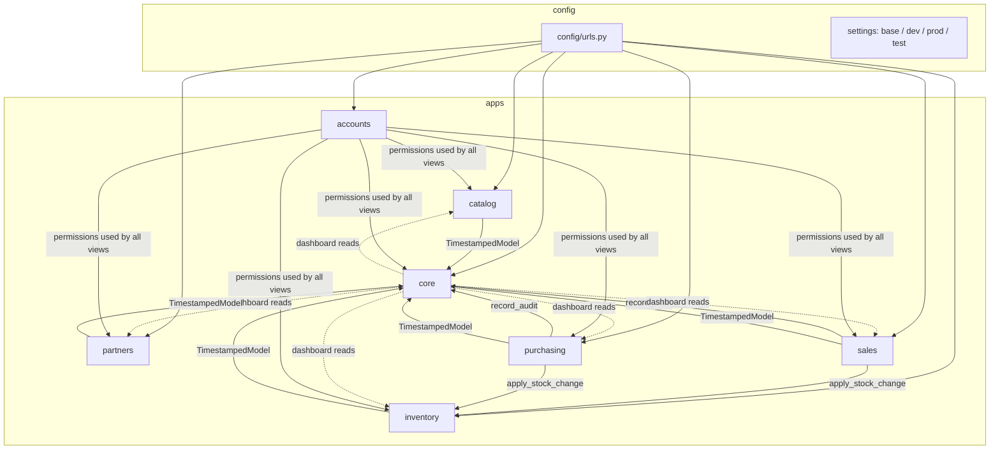
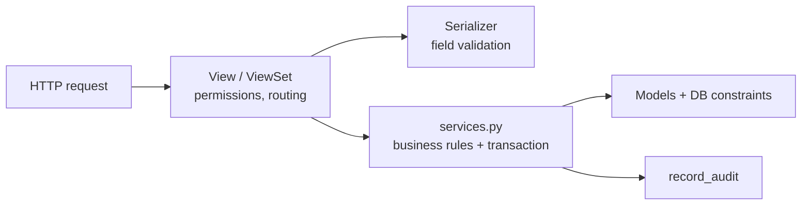
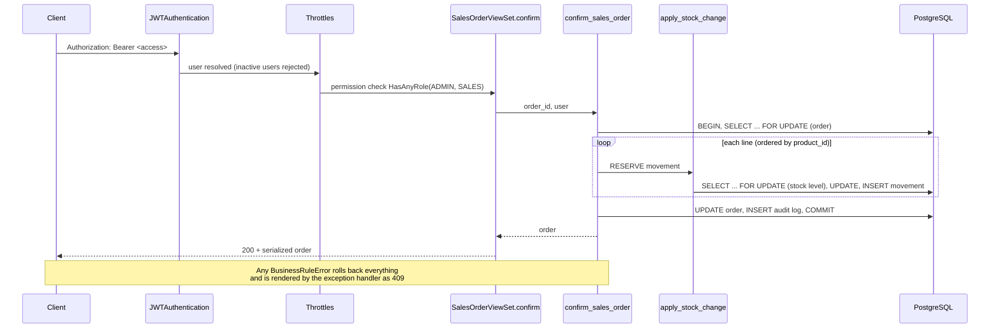

# 02 — Architecture

[← 01 Overview](01-project-overview.md) · [README](../README.md) · Next: [03 Database design](03-database-design.md)

## Technical architecture

StockFlow is a classic **modular monolith**: one Django project (`config/`) composed of seven Django apps under `apps/`, exposing a versioned JSON API under `/api/v1/`. There is no front-end, message queue, cache or background worker.



## Django apps and responsibilities

| App | Models | Layers present | Notes |
|---|---|---|---|
| `accounts` | `User` | models, serializers, views, viewsets, permissions, urls | Custom user, `USERNAME_FIELD = "email"`, `role` field. Permission helpers `IsAuthenticatedAndActive`, `IsAdminRole`, `HasAnyRole(...)` |
| `partners` | `Customer`, `Supplier` | models, serializers, viewsets, urls | Both extend an abstract `BasePartner` |
| `catalog` | `Category`, `Product` | models, serializers, filters, views, urls | `ProductFilter` adds price range and category-name filters |
| `inventory` | `Warehouse`, `StockLevel`, `StockMovement` | models, serializers, **services**, views, urls | `services.py` is the only place stock quantities change |
| `sales` | `SalesOrder`, `SalesOrderLine` | models, serializers, filters, **services**, views, urls | Services: confirm / ship / cancel |
| `purchasing` | `PurchaseOrder`, `PurchaseOrderLine`, `Receipt`, `ReceiptLine` | models, serializers, **services**, views, urls | Services: place / cancel / receive |
| `core` | `AuditLog` (+ abstract `TimestampedModel`) | models, audit helper, exceptions, handlers, pagination, dashboard views, `seed_demo` command | Shared infrastructure |

Dependencies point one way: `sales` and `purchasing` call `inventory` services and `core` helpers; `inventory` knows nothing about orders. `core.views` imports the other apps only to read statistics for the dashboard.

## Layering inside an app



| Layer | Responsibility | Example |
|---|---|---|
| Views | Select permissions per action, parse input, call services, shape the response | `SalesOrderViewSet.get_permissions`, `confirm` action |
| Serializers | Field-level and cross-field validation of **input data** (active customer, no duplicate product in lines) | `SalesOrderSerializer.validate` |
| Services | State transitions and stock changes, always inside `transaction.atomic` with row locks | `confirm_sales_order`, `receive_purchase_order` |
| Models | Data shape and database constraints (`CheckConstraint`, `UniqueConstraint`) | `StockLevel` constraints |
| Core helpers | Audit trail, exceptions, error format | `record_audit`, `BusinessRuleError` |

CRUD on simple resources (partners, catalog, warehouses) uses DRF `ModelViewSet`s directly; only workflows with state or stock impact have a service layer.

## Request lifecycle

Example: `POST /api/v1/sales/sales-orders/{id}/confirm/`



Global DRF settings (`config/settings/base.py`):

| Setting | Value |
|---|---|
| Authentication | `JWTAuthentication` only |
| Default permission | `IsAuthenticated` (every view overrides or inherits it) |
| Filter backends | `DjangoFilterBackend`, `SearchFilter`, `OrderingFilter` |
| Pagination | `StandardResultsSetPagination` — `page_size` 20, `page_size` query param, max 100 |
| Throttling | anon 30/min, user 300/min, scope `login` 5/min (applied to the token endpoint) |
| Exception handler | `apps.core.handlers.api_exception_handler` |
| Schema | `drf_spectacular.openapi.AutoSchema` |

## Error handling

`api_exception_handler` normalises errors into one envelope:

```json
{ "error": { "code": "...", "message": "...", "details": { } } }
```

| Source | HTTP | `code` |
|---|---|---|
| DRF `ValidationError` | 400 | `validation_error` |
| Authentication / permission / 405 / etc. | 401 / 403 / 405 | DRF exception `default_code` (for example `not_authenticated`, `method_not_allowed`) |
| Django `Http404` (from `get_object`) | 404 | `request_error` (observed) |
| `BusinessRuleError` subclasses | 409 | `business_rule_violation`, `invalid_transition`, `insufficient_stock`, `over_receipt`, `empty_order`, `idempotency_conflict` |
| `ProtectedError` (FK `PROTECT`) | 409 | `resource_in_use` |
| Any other exception | 500 | Logged server-side (`Unhandled API exception`); handler returns `None` so Django produces a generic 500 |

One endpoint does not follow the envelope: deleting a category that is in use returns `{"code": "resource_in_use", "detail": "..."}` (see [11 Technical decisions](11-technical-decisions.md#inconsistencies-found-during-the-documentation-audit)).

## Settings layout

| File | Purpose |
|---|---|
| `config/settings/base.py` | Shared settings; reads `.env` through django-environ |
| `dev.py` | `DEBUG = True` (default module in `manage.py`, `wsgi.py`, `asgi.py`) |
| `prod.py` | `DEBUG = False`, WhiteNoise, HTTPS/proxy/cookie hardening |
| `test.py` | `DEBUG = False`, fast MD5 password hasher (used by `pytest.ini`) |

## Important architectural decisions (summary)

| Decision | Short reason |
|---|---|
| Service layer for stock-affecting workflows | Keeps rules and transactions out of views; reusable and directly testable |
| Single stock-mutation function (`apply_stock_change`) | One place enforces invariants and writes the ledger |
| Row-level locking (`select_for_update`) in PostgreSQL | Prevents overselling under concurrency |
| DB constraints in addition to Python checks | Invariants survive bugs in application code |
| Immutable movement ledger | Traceability; stock level can be reconciled against movements |
| Custom exception hierarchy → HTTP 409 | Distinguishes "valid request, forbidden by current state" from 400 validation errors |

The full discussion with trade-offs is in [11 Technical decisions](11-technical-decisions.md).
