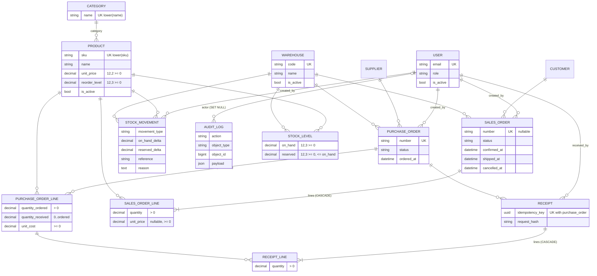

# 03 — Database design

[← 02 Architecture](02-architecture.md) · [README](../README.md) · Next: [04 Business workflows](04-business-workflows.md)

The database is **PostgreSQL 16** (Docker Compose and CI). Tests assert the backend is PostgreSQL (`tests/test_smoke.py`). Primary keys are `BigAutoField`. Datetimes are timezone-aware (`USE_TZ = True`, `TIME_ZONE = "UTC"`).

## Entity-relationship diagram

Derived from the models in `apps/*/models.py`. Foreign keys use `PROTECT` unless noted.

`Customer` and `Supplier` share the same columns (`name`, `email`, `phone`, `address`, `is_active`) through an abstract base class; they are separate tables.

## Models and responsibilities

| Model | App | Responsibility |
|---|---|---|
| `User` | accounts | Account with unique email and a `role` (`ADMIN`, `STOCK_MANAGER`, `SALES`, `PURCHASER`, `VIEWER`; default `VIEWER`). Extends `AbstractUser`; `username` is set to the email by the manager |
| `Customer`, `Supplier` | partners | Trading partners, deactivated through `is_active` |
| `Category`, `Product` | catalog | Product master data. Price in `unit_price`; `reorder_level` feeds the dashboard low-stock indicator |
| `Warehouse` | inventory | Storage location with unique `code` |
| `StockLevel` | inventory | Quantity of one product in one warehouse: `on_hand`, `reserved`; `available` is a Python property (`on_hand − reserved`) |
| `StockMovement` | inventory | Immutable ledger line; types `RECEIPT`, `SHIPMENT`, `RESERVE`, `RELEASE`, `ADJUSTMENT` |
| `SalesOrder`, `SalesOrderLine` | sales | Customer order; line `unit_price` stays `NULL` until confirmation |
| `PurchaseOrder`, `PurchaseOrderLine` | purchasing | Supplier order; `number` is generated as `PO-` + 12 hex characters |
| `Receipt`, `ReceiptLine` | purchasing | One goods-receipt event and the quantities received per order line |
| `AuditLog` | core | Immutable event record with JSON payload |

Number formats: sales orders get `SO-{pk:06d}` after insertion (the column is nullable for that reason); purchase orders get a random `PO-XXXXXXXXXXXX` at creation.

## Constraints

All constraints below exist in the models (and therefore in migrations; CI runs `makemigrations --check`).

| Table | Constraint | Rule |
|---|---|---|
| `catalog_category` | `uniq_category_name_ci` | Unique `lower(name)` |
| `catalog_product` | `uniq_product_sku_ci` | Unique `lower(sku)` |
| | `product_price_gte_0`, `product_reorder_level_gte_0` | Non-negative price and reorder level |
| `partners_customer` / `partners_supplier` | `unique_customer_email_if_provided`, `unique_supplier_email_if_provided` | Partial unique index on `email` when not null and not empty |
| `inventory_warehouse` | unique `code` | |
| `inventory_stocklevel` | `uniq_stock_level_product_warehouse` | One row per (product, warehouse) |
| | `stock_on_hand_gte_0`, `stock_reserved_gte_0` | Non-negative quantities |
| | `stock_reserved_lte_on_hand` | `reserved <= on_hand` |
| `inventory_stockmovement` | `adjustment_requires_reason` | `ADJUSTMENT` rows must have a non-empty `reason` |
| `sales_salesorder` | unique `number` | |
| `sales_salesorderline` | `uniq_sales_order_product` | A product appears once per order |
| | `sales_line_quantity_gt_0`, `sales_line_price_gte_0` | Positive quantity; price null or ≥ 0 |
| `purchasing_purchaseorder` | unique `number` | |
| `purchasing_purchaseorderline` | `uniq_purchase_order_product` | A product appears once per order |
| | `po_line_quantity_ordered_gt_zero`, `po_line_quantity_received_gte_zero`, `po_line_received_lte_ordered`, `po_line_unit_cost_gte_zero` | Quantity bounds |
| `purchasing_receipt` | `uniq_receipt_order_idempotency` | Unique (`purchase_order`, `idempotency_key`) — the idempotency guarantee |
| `purchasing_receiptline` | `uniq_receipt_purchase_order_line`, `receipt_line_quantity_gt_zero` | |

## Indexes

Beyond the indexes implied by unique constraints and foreign keys:

| Table | Index |
|---|---|
| `sales_salesorder` | `status` (`db_index`), (`status`, `created_at`) as `sales_status_created_idx`, (`customer`, `created_at`) as `sales_customer_created_idx` |
| `core_auditlog` | (`object_type`, `object_id`) as `audit_object_idx`, (`action`, `created_at`) as `audit_action_created_idx` |

## Referential integrity and deletion rules

- Almost every foreign key is `on_delete=PROTECT`: a product, customer, supplier, warehouse or user that is referenced cannot be deleted. The API turns the resulting `ProtectedError` into HTTP 409 `resource_in_use`.
- Order lines and receipt lines use `CASCADE` from their parent.
- `AuditLog.actor` is `SET_NULL`, so audit rows survive user removal.
- There is no product or warehouse delete endpoint; products are deactivated instead.

## Immutability: how it is enforced

| Model | Mechanism | Level |
|---|---|---|
| `StockMovement` | `save()` raises `PermissionDenied` if the object already has a primary key; `delete()` raises; the default manager returns a queryset whose `update()` and `delete()` raise | Application (Python) |
| `AuditLog` | `save()` raises if the row exists; `delete()` raises; queryset `update()` / `delete()` raise `ValidationError` | Application (Python) |

These guards are **not database triggers**. From code inspection, `bulk_create` and raw SQL are not blocked; the guarantee holds for normal ORM use. Tests: `test_stock_movement_cannot_be_modified`, `test_audit_log_cannot_be_modified`, `test_audit_log_cannot_be_updated`.

## Ledger consistency

For every `StockLevel`, the sum of `on_hand_delta` and `reserved_delta` over its `StockMovement` rows must equal `on_hand` and `reserved`. `tests/helpers.py::assert_ledger_consistent` checks this invariant and is used after stock operations in the tests. The `seed_demo` command writes a `RECEIPT` movement for each stock level it creates so the invariant holds for demo data as well.

## Migrations

Each app has a `migrations/` package (accounts 2, catalog 2, sales 3, others 1 each). Ruff excludes `migrations/` from linting. The `token_blacklist` tables come from `rest_framework_simplejwt.token_blacklist`.
