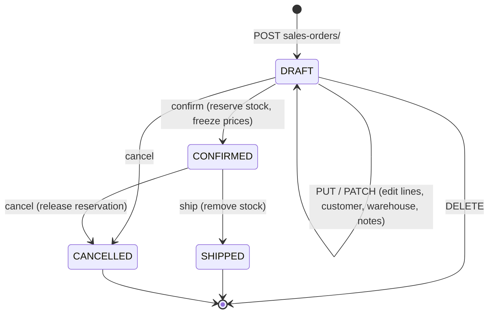
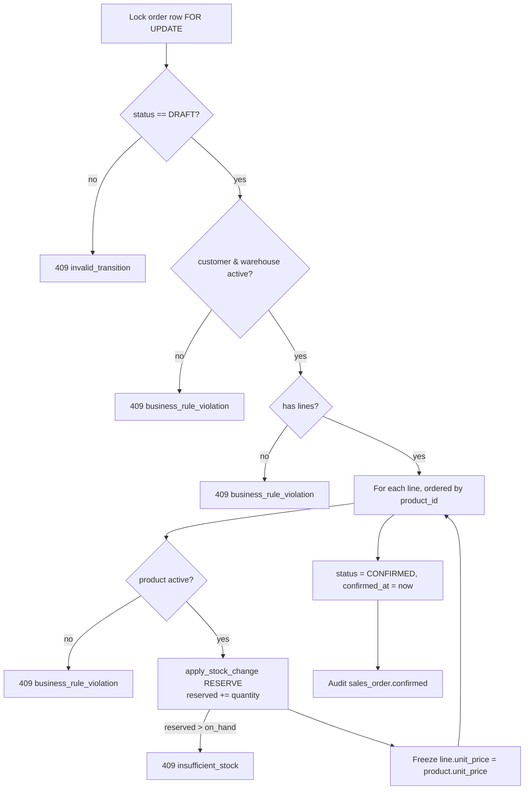
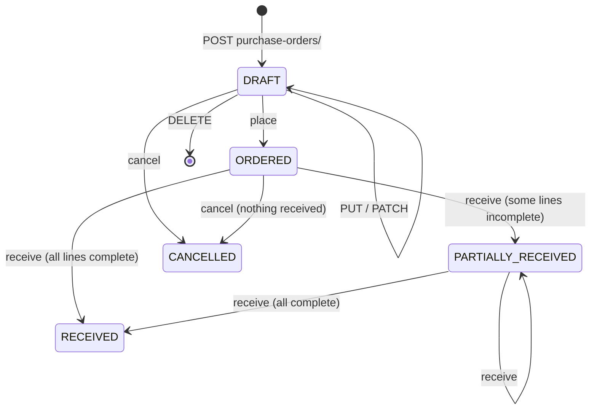
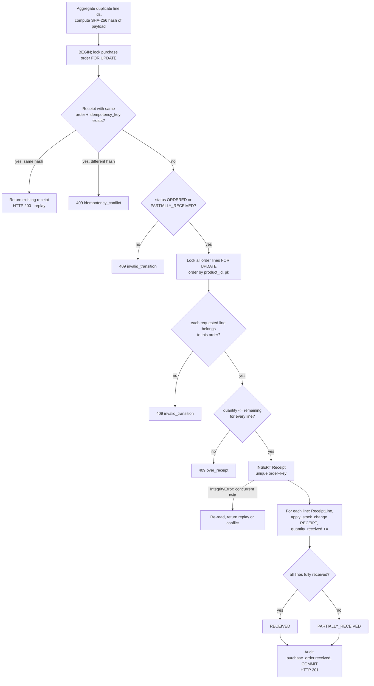

# 04 — Business workflows

[← 03 Database design](03-database-design.md) · [README](../README.md) · Next: [05 Authentication and permissions](05-authentication-and-permissions.md)

This document describes the sales and purchasing workflows as implemented in `apps/sales/` and `apps/purchasing/`. The stock mechanics they rely on are explained in [07 Inventory and stock management](07-inventory-and-stock-management.md). Endpoint details are in [06 API reference](06-api-reference.md).

## Sales workflow

### States

Only `DRAFT` orders can be edited or deleted. `SHIPPED` and `CANCELLED` are terminal. Any other transition returns HTTP 409 `invalid_transition` with `details.current_status`.

### Operations

| Operation | Endpoint | Roles | Effect |
|---|---|---|---|
| Create | `POST /api/v1/sales/sales-orders/` | ADMIN, SALES | Creates a `DRAFT` order and its lines; `number` = `SO-{pk:06d}`; `created_by` = caller; audit `sales_order.created`. Line `unit_price` is `null` |
| Update | `PUT` / `PATCH …/{id}/` | ADMIN, SALES | Draft only. If `lines` is sent, **all existing lines are replaced**. Audit `sales_order.updated` |
| Delete | `DELETE …/{id}/` | ADMIN, SALES | Draft only; audit `sales_order.deleted` is written before the delete |
| Confirm | `POST …/{id}/confirm/` | ADMIN, SALES | See below |
| Ship | `POST …/{id}/ship/` | ADMIN, STOCK_MANAGER | See below |
| Cancel | `POST …/{id}/cancel/` | ADMIN, SALES | See below |

Validation on create/update (`SalesOrderSerializer.validate`): customer and warehouse must be active; a product may appear only once per order; products must be active. Read-only fields: `number`, `status`, `created_by`, timestamps, `total`, and line `unit_price`/`line_total`.

### Confirm (`confirm_sales_order`)

The whole function runs in one transaction (`@transaction.atomic`). If any line lacks stock, nothing is reserved and no price is frozen: it is **all or nothing** (test `test_confirm_order_with_insufficient_stock_rolls_back_everything`). Prices are copied from the product at confirmation time, so later price changes do not alter a confirmed order (test `test_price_is_frozen_at_confirmation`).

### Ship (`ship_sales_order`)

Requires status `CONFIRMED`. For each line (ordered by `product_id`) it applies a `SHIPMENT` movement with `on_hand_delta = −quantity` and `reserved_delta = −quantity`, then sets `SHIPPED` and `shipped_at`, and writes audit `sales_order.shipped`.

### Cancel (`cancel_sales_order`)

Allowed from `DRAFT` or `CONFIRMED`. A `DRAFT` order cancels without any stock movement. A `CONFIRMED` order applies a `RELEASE` movement per line (`reserved_delta = −quantity`, reason `"Sales order cancelled"`). Sets `CANCELLED`, `cancelled_at`, audit `sales_order.cancelled`.

### Example (captured from a local run on demo data)

| Step | Result |
|---|---|
| Create order for 2 × product 1 | `201`, status `DRAFT`, `unit_price: null` |
| Confirm | `200`, `CONFIRMED`, `unit_price: "85.00"`, total `"170.000"`; stock level: `on_hand 10.000`, `reserved 2.000`, `available 8.000` |
| Ship | `200`, `SHIPPED`; stock level: `on_hand 8.000`, `reserved 0.000` |
| Cancel the shipped order | `409`, `invalid_transition`, `current_status: SHIPPED` |
| Confirm an order for 9999 × product 2 | `409`, `insufficient_stock`, `available: "10.000"` |

## Purchasing workflow

### States

### Operations

| Operation | Endpoint | Roles | Rules |
|---|---|---|---|
| Create | `POST /api/v1/purchasing/purchase-orders/` | ADMIN, PURCHASER | Creates a `DRAFT`; lines optional at creation. Supplier and warehouse must be active; a product may appear once. Audit `purchase_order.created` |
| Update / delete | `PUT`, `PATCH`, `DELETE …/{id}/` | ADMIN, PURCHASER | Draft only (409 `invalid_transition` otherwise). If `lines` is sent, existing lines are replaced (refused if any quantity was received) |
| Place | `POST …/{id}/place/` | ADMIN, PURCHASER | `DRAFT → ORDERED`. Supplier and warehouse must be active; at least one line (`empty_order`). **No stock movement.** Audit `purchase_order.placed` |
| Cancel | `POST …/{id}/cancel/` | ADMIN, PURCHASER | Only `DRAFT` or `ORDERED`, and only if no line has `quantity_received > 0`. Audit `purchase_order.cancelled` |
| Receive | `POST …/{id}/receive/` | ADMIN, STOCK_MANAGER | See below |
| List / read receipts | `GET /api/v1/purchasing/receipts/` | any authenticated active user | Read-only |

Line fields on write: `product`, `quantity_ordered` (> 0), `unit_cost` (≥ 0). Update and delete of purchase orders do not write audit entries.

### Receive (`receive_purchase_order`)

Request body: `idempotency_key` (UUID) and a non-empty list of `{purchase_order_line, quantity}` with `quantity ≥ 0.001`.

Key properties:

- **Idempotency.** Replaying the same key and the same payload returns the existing receipt with HTTP **200** (first success is **201**) and does not change stock. The same key with another payload returns 409 `idempotency_conflict`. The replay check runs before the status check, so a successful request can be replayed even after the order became `RECEIVED`.
- **Duplicate lines** in one request are summed before validation (`test_duplicate_lines_are_aggregated`).
- **All-or-nothing validation.** Every requested line is validated before anything is written; any failure aborts the whole receipt.
- **No over-receipt**, enforced in the service and by the `po_line_received_lte_ordered` check constraint.
- **Concurrency.** The purchase order row is locked first, so two receipts on the same order are serialised (see [07](07-inventory-and-stock-management.md#concurrency-and-locking)).

Example (captured on demo data): order line of 5.000 units; receive 2.000 → `201` and status `PARTIALLY_RECEIVED`; same key and payload again → `200`; same key with 3.000 → `409 idempotency_conflict`; new key with 99.000 → `409 over_receipt` with `remaining: "3.000"`.

## Reservation and availability rules (summary)

| Rule | Where enforced |
|---|---|
| Only confirming a sales order reserves stock | `confirm_sales_order` |
| `available = on_hand − reserved` | `StockLevel.available`; SQL annotation in the stock-levels list |
| `reserved` can never exceed `on_hand`, nor either go below 0 | `apply_stock_change` and DB check constraints |
| Shipping consumes the reservation and the physical stock together | `ship_sales_order` |
| Placing a purchase order changes no stock; only receipts add stock | `place_purchase_order`, `receive_purchase_order` |
