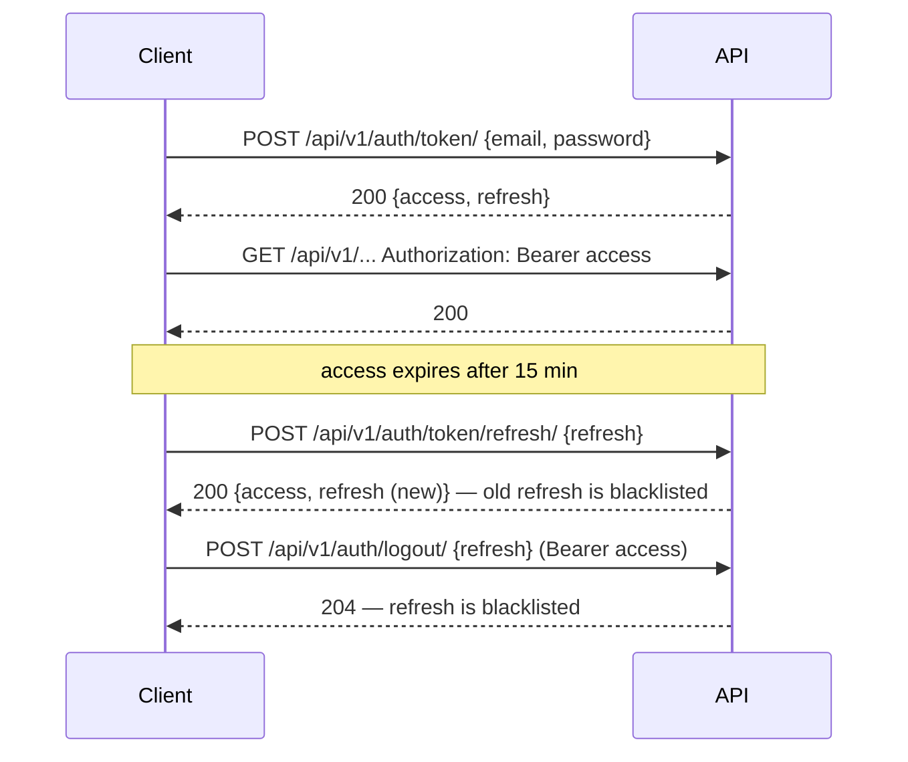

# 05 — Authentication and permissions

[← 04 Business workflows](04-business-workflows.md) · [README](../README.md) · Next: [06 API reference](06-api-reference.md)

## Authentication mechanism

The API uses **JWT bearer tokens** through `djangorestframework-simplejwt`. It is the only authentication class configured (`DEFAULT_AUTHENTICATION_CLASSES`); sessions are used only by the Django admin site at `/admin/`.

| Item | Value (from `config/settings/base.py`) |
|---|---|
| Login identifier | Email (`User.USERNAME_FIELD = "email"`) |
| Access token lifetime | 15 minutes |
| Refresh token lifetime | 1 day |
| Refresh rotation | `ROTATE_REFRESH_TOKENS = True` |
| Blacklist after rotation | `BLACKLIST_AFTER_ROTATION = True` (app `rest_framework_simplejwt.token_blacklist`) |
| Login throttle | scope `login`, 5 requests/minute |

- Inactive users cannot log in and their tokens are rejected (tests: `test_inactive_user_cannot_login`, `test_inactive_user_cannot_read_products`).
- Reusing an old refresh token after rotation is rejected (`test_refresh_rotation_invalidates_old_refresh`); logout blacklists the refresh token (`test_logout_blacklists_refresh`); an expired access token is rejected (`test_expired_access_token_is_rejected`).
- Users cannot self-register. Accounts are created by an administrator (`POST /api/v1/users/`) or with `createsuperuser`. There is no password-reset or password-change endpoint.

## Roles

`User.role` (default `VIEWER`):

| Role | Meaning |
|---|---|
| `ADMIN` | Full access, including user management and the audit log |
| `STOCK_MANAGER` | Catalog, warehouses, stock adjustments, shipping sales orders, receiving purchase orders |
| `SALES` | Customers and sales orders (except shipping) |
| `PURCHASER` | Suppliers and purchase orders (except receiving) |
| `VIEWER` | Read-only |

`createsuperuser` always assigns role `ADMIN` (the custom manager forces `is_staff`, `is_superuser`, `is_active` and the role).

## Permission classes (`apps/accounts/permissions.py`)

| Class | Behaviour |
|---|---|
| `IsAuthenticatedAndActive` | Authenticated and `is_active` |
| `IsAdminRole` | Authenticated, active and `role == ADMIN` |
| `HasAnyRole(*roles, read_for_all=False)` | Factory returning a permission class: allows listed roles; with `read_for_all=True`, any active authenticated user may use `GET`/`HEAD`/`OPTIONS`. Called with no roles, only safe methods (when `read_for_all`) or nobody is allowed |

Each ViewSet selects permissions in `get_permissions()` according to `self.action`. There are no object-level permissions: any user allowed to act on a resource type can act on any instance (for example, a sales user can see and edit all sales orders, not only their own).

## Permission matrix

Legend: ✔ allowed · ✘ forbidden (403) · "any" = any authenticated active user. Derived from the `get_permissions()` implementations.

| Resource / action | ADMIN | STOCK_MANAGER | SALES | PURCHASER | VIEWER |
|---|:-:|:-:|:-:|:-:|:-:|
| Users: list, retrieve, create, update | ✔ | ✘ | ✘ | ✘ | ✘ |
| Users: delete | not available (405) | | | | |
| Audit logs: list, retrieve | ✔ | ✘ | ✘ | ✘ | ✘ |
| Dashboard summary | ✔ | ✔ | ✔ | ✔ | ✔ |
| Customers: read | ✔ | ✔ | ✔ | ✔ | ✔ |
| Customers: create, update (PUT/PATCH) | ✔ | ✘ | ✔ | ✘ | ✘ |
| Customers: delete | ✔ | ✘ | ✘ | ✘ | ✘ |
| Suppliers: read | ✔ | ✔ | ✔ | ✔ | ✔ |
| Suppliers: create, update | ✔ | ✘ | ✘ | ✔ | ✘ |
| Suppliers: delete | ✔ | ✘ | ✘ | ✘ | ✘ |
| Categories / products: read | ✔ | ✔ | ✔ | ✔ | ✔ |
| Categories: create, update | ✔ | ✔ | ✘ | ✘ | ✘ |
| Categories: delete | ✔ | ✘ | ✘ | ✘ | ✘ |
| Products: create, update, deactivate | ✔ | ✔ | ✘ | ✘ | ✘ |
| Warehouses: read | ✔ | ✔ | ✔ | ✔ | ✔ |
| Warehouses: create, update | ✔ | ✔ | ✘ | ✘ | ✘ |
| Stock levels, stock movements: read | ✔ | ✔ | ✔ | ✔ | ✔ |
| Stock adjustments: create | ✔ | ✔ | ✘ | ✘ | ✘ |
| Sales orders: read | ✔ | ✔ | ✔ | ✔ | ✔ |
| Sales orders: create, update, delete, confirm, cancel | ✔ | ✘ | ✔ | ✘ | ✘ |
| Sales orders: ship | ✔ | ✔ | ✘ | ✘ | ✘ |
| Purchase orders: read | ✔ | ✔ | ✔ | ✔ | ✔ |
| Purchase orders: create, update, delete, place, cancel | ✔ | ✘ | ✘ | ✔ | ✘ |
| Purchase orders: receive | ✔ | ✔ | ✘ | ✘ | ✘ |
| Receipts: read | ✔ | ✔ | ✔ | ✔ | ✔ |

Test coverage of this matrix: `tests/accounts/test_permissions_matrix.py` (create endpoints for categories, products, customers, suppliers, warehouses across all five roles), `tests/accounts/test_anonymous_access.py` (12 endpoints require authentication), plus per-app permission tests (partners, catalog, purchasing, sales, inventory, audit logs). Not every cell above has a dedicated test; for example, update/delete rights on every resource and the dashboard permission are not individually tested.

## Public and protected endpoints

| Endpoint | Access |
|---|---|
| `POST /api/v1/auth/token/` | Public (login throttle) |
| `POST /api/v1/auth/token/refresh/` | Public (needs a valid refresh token) |
| `GET /api/v1/health/` | Public |
| `GET /api/schema/`, `/api/schema/swagger-ui/`, `/api/schema/redoc/` | Public (anonymous requests to Swagger UI and ReDoc returned 200 in the verification run) |
| `POST /api/v1/auth/logout/`, `GET /api/v1/auth/me/` | Any authenticated user |
| Everything else under `/api/v1/` | Authenticated and active, then role rules above |
| `/admin/` | Django admin (session login); only catalog and purchasing models are registered |

## User management rules

- `UserSerializer` exposes `email`, `first_name`, `last_name`, `role`, `is_active`, write-only `password` and read-only `id`, `username`, `date_joined`. Passwords are validated with Django's password validators and hashed with `set_password`.
- An administrator cannot remove their own admin role or deactivate themselves if they are the **last active administrator** (`ValidationError` on `role`). The rule applies only when editing one's own account; it does not stop an admin from demoting another admin.
- Users are never deleted through the API (`DELETE` returns 405); deactivate with `is_active=false`.

## Security notes

- **Mass-assignment protection:** `status`, `number`, `confirmed_at`/`shipped_at`/`cancelled_at`, line `unit_price` and `total` on sales orders are read-only; stock levels and movements are read-only resources.
- **Refresh token in the response body.** The refresh token is returned as JSON, not as an HttpOnly cookie; clients must store it carefully.
- **Throttling is per process.** Rates are `anon 30/min`, `user 300/min`, `login 5/min`, but no `CACHES` setting exists, so Django's default local-memory cache is used and each gunicorn worker counts separately.
- **CORS:** `corsheaders` is in `INSTALLED_APPS`, but `CorsMiddleware` is not in `MIDDLEWARE` and no `CORS_*` settings exist, so CORS headers are not sent.
- **Production hardening** (in `config/settings/prod.py`, effective only when that settings module is active): `SECURE_PROXY_SSL_HEADER`, `SECURE_SSL_REDIRECT` (default on, health check exempt), secure session/CSRF cookies, optional HSTS (`SECURE_HSTS_SECONDS`, default 0).
- **Secrets:** `SECRET_KEY` and `DATABASE_URL` are required environment variables; `.env` is git-ignored and excluded by `.dockerignore`.
- No account lockout, MFA or password-reset flow is implemented.
