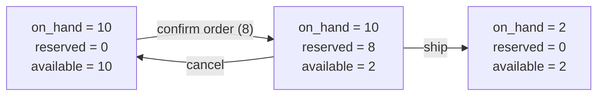

# 07 — Inventory and stock management

[← 06 API reference](06-api-reference.md) · [README](../README.md) · Next: [08 Testing and quality](08-testing-and-quality.md)

Source: `apps/inventory/models.py`, `apps/inventory/services.py`, `apps/inventory/views.py`.

## Stock levels

A `StockLevel` holds the quantities of **one product in one warehouse** (unique pair). Created lazily by the first stock change if missing (and by `seed_demo`).

| Field | Meaning |
|---|---|
| `on_hand` | Physical quantity (≥ 0) |
| `reserved` | Quantity promised to confirmed sales orders (≥ 0, ≤ `on_hand`) |
| `available` | `on_hand − reserved`; not stored. A Python property on the model; the list endpoint computes it in SQL (`available_qty`) so it can be filtered |

`GET /api/v1/inventory/stock-levels/?low_stock=true&threshold=5` returns levels with `available <= threshold` (default threshold `5.000`, must be a finite non-negative decimal). Stock levels are read-only through the API; they change only through movements.

## Stock movements (the ledger)

Every change to `on_hand` or `reserved` creates a `StockMovement` with signed deltas:

| `movement_type` | `on_hand_delta` | `reserved_delta` | Created by |
|---|---|---|---|
| `RECEIPT` | + | 0 | Purchase receipt (`receive_purchase_order`); also `seed_demo` |
| `RESERVE` | 0 | + | Sales order confirmation |
| `RELEASE` | 0 | − | Cancelling a confirmed sales order |
| `SHIPMENT` | − | − | Shipping a sales order |
| `ADJUSTMENT` | ± | 0 | `POST /inventory/stock-adjustments/` |

Each movement also stores `product`, `warehouse`, `reference` (the order number for order-driven movements), `reason` (mandatory for adjustments, enforced by a DB check), `created_by` and `created_at`. Movements are read-only in the API (`GET` list/detail only) and immutable at model level ([03](03-database-design.md#immutability-how-it-is-enforced)). The list is filterable by `product`, `warehouse`, `movement_type`, `created_at__gte`, newest first.

Invariant (checked by `assert_ledger_consistent` in tests): per stock level, `Σ on_hand_delta = on_hand` and `Σ reserved_delta = reserved`.

## The single mutation point: `apply_stock_change`

All order workflows and adjustments change stock through this function.

```python
apply_stock_change(*, product_id, warehouse_id, movement_type,
                   on_hand_delta=0, reserved_delta=0, user, reference="", reason="")
```

Steps (as implemented):

1. **Must run inside a transaction**, otherwise it raises `RuntimeError` (test `test_apply_stock_change_requires_transaction`).
2. **Lock the row.** `_locked_level` first tries `get_or_create` inside a nested `atomic` block (savepoint) so a concurrent creation of the same pair does not break the transaction (`IntegrityError` is swallowed), then re-reads the row with `select_for_update()`.
3. Compute `new_on_hand` and `new_reserved`.
4. **Validate:** if `new_on_hand < 0`, `new_reserved < 0` or `new_reserved > new_on_hand`, raise `InsufficientStock` (HTTP 409) with `product`, `warehouse`, `available` and `requested_change`.
5. Save the level (`update_fields` = `on_hand`, `reserved`, `updated_at`).
6. Insert the `StockMovement` and return it.

Because the check happens on the locked row, two transactions cannot both read the same "available" value and both succeed.

## Available versus reserved



- Reserving more than `available` fails (`reserved` would exceed `on_hand`).
- A negative adjustment cannot push `on_hand` below `reserved` (same check; test `test_adjustment_cannot_go_below_reserved`).

## Stock adjustments

`POST /api/v1/inventory/stock-adjustments/` (ADMIN, STOCK_MANAGER). Body: `product`, `warehouse`, `quantity_delta` (non-zero, 3 decimals), `reason` (required, non-blank).

- Input is validated by `StockAdjustmentInputSerializer` (zero delta and blank reason → 400). The service `adjust_stock` (`@transaction.atomic`) repeats the checks as `BusinessRuleError`, then calls `apply_stock_change` with `ADJUSTMENT`.
- Success returns `201` with the movement. Reducing stock below what is available returns `409 insufficient_stock`.
- **No audit-log entry is written for adjustments**; the permanent record is the `ADJUSTMENT` movement itself (with `reason` and `created_by`).

## Concurrency and locking

| Mechanism | Where | Purpose |
|---|---|---|
| `transaction.atomic` | Every service; `@transaction.atomic` on `confirm`/`ship`/`cancel`/`adjust_stock`, `with transaction.atomic()` in purchasing services | All-or-nothing: partial reservations or receipts are rolled back |
| `select_for_update` on the order | `_get_locked_order` (sales), purchase order lookups | Serialises concurrent transitions of the same order |
| `select_for_update` on purchase order lines | `receive_purchase_order` (ordered by `product_id, pk`) | Prevents two receipts from over-receiving a line |
| `select_for_update` on the stock level | `_locked_level` | Serialises concurrent changes to the same product/warehouse |
| Deterministic lock order | Sales services iterate lines `order_by("product_id")` | Reduces deadlock risk between orders sharing products |
| Check constraints | `StockLevel`, `PurchaseOrderLine` | Last line of defence if application code were wrong |
| Unique constraint + `IntegrityError` handling | `Receipt(purchase_order, idempotency_key)` | Concurrent identical receive requests produce one receipt |

Evidence in the test suite (all run against PostgreSQL with real threads; marker `slow`, `transaction=True`):

| Test | Scenario | Asserted outcome |
|---|---|---|
| `test_concurrent_confirmations_never_oversell` | 5 orders of 8 units, stock 10 | exactly 1 confirmed, 4 `InsufficientStock`; `reserved = 8 ≤ on_hand = 10` |
| `test_concurrent_confirmation_and_cancellation` | confirm and cancel the same order simultaneously | final status `CANCELLED`, `reserved = 0`, `on_hand` unchanged |
| `test_concurrent_receipts_never_over_receive` | 2 receipts of 15 on a 25-unit line | 1 succeeds, 1 `OverReceipt`; received = 15 |
| `test_concurrent_receipts_same_key_create_one_receipt` | same idempotency key twice in parallel | one receipt, one replay |

Limits of this evidence: the tests use two to five threads and finish in seconds; they demonstrate the behaviour for those scenarios, not exhaustive proof. Not covered by any test (from code inspection only): purchase receipts lock stock levels in purchase-order-line order while sales services lock them in `product_id` order, so a receipt and a sales confirmation touching the same products in opposite order could theoretically deadlock; PostgreSQL would abort one of the transactions, which the API does not specifically handle. Treat this as a possible improvement rather than a demonstrated defect.

## Operational notes

- `seed_demo` creates stock levels and matching `RECEIPT` movements directly (not through `apply_stock_change`) in one transaction, attributing them to a technical user `demo.admin@stockflow.local` with an unusable password. It is idempotent (`get_or_create`) and has no automated tests.
- Dashboard stock figures are computed by aggregation queries on `StockLevel`; see [06](06-api-reference.md#examples) for definitions. The stock value uses the **current list price**, not a cost method, so it is indicative only.
